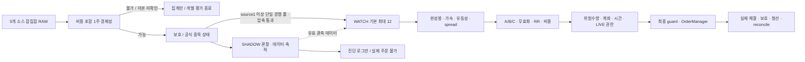

# 주식자동매매 V1.3 — 개장 전 준비와 증거 기반 readiness

빌드: **V1.3-preopen-risk2-20261007** / 전략 식별자: `V1.1-policy-20261001` / 위험관리 실험: `20261007-risk2-daily4-cap20000`.
A/B/C 형상·신호 임계값은 그대로이므로 전략 식별자는 유지합니다. 빌드는 운영 readiness 변경을, 실험 식별자는 2026-10-07 위험예산 변경을 구분합니다. 모든 판단 기록과 신규 승인/준비 증빙은 현재 빌드와 연결됩니다.
기존 주문·체결·복구 코어를 유지하면서 후보 관찰, 평가 연결, 부하와 사용자 시작 절차를 수정했습니다. 회귀검사와 합성 경로 검증은 수익성이나 실제 매수·청산 체결 성공을 증명하지 않습니다.

## 사용자가 평소 할 일

바탕화면 **주식자동매매** 폴더 안의 **주식자동매매_실행.cmd**를 더블클릭합니다. 창을 여는 것만으로 주문하지 않습니다. **08:00 이후 자동매매 시작**으로 당일 준비를 시작하고, 실제 운용을 선택했다면 현재 승인한도와 명시 승인 문구를 확인합니다. 프로그램이 사용자 승인을 대신 만들지 않습니다.

- 08:00부터 설정·빌드·보호정책·HALT/UNKNOWN·장부·미체결·인증정보 및 가능한 계좌조회 준비를 검사합니다. 정규장 틱이나 시장상태 `3`은 개장 전 검사 조건이 아닙니다. 실제 연결/계좌조회가 확인되지 않은 항목은 미확인 또는 차단 사유로 표시합니다.
- 조회 검사를 끝내려고 임의로 한도를 0원으로 되돌리거나 확인된 비용을 미확정으로 바꿀 필요가 없습니다. 검사와 실제 주문 권한을 분리합니다.
- 양수 한도는 실제 비용 확인과 당일 LIVE 명시승인이 필요합니다. 승인은 거래일·현재 빌드·config·automation·보호정책에 결합됩니다. 한도/설정/빌드 변경 또는 중요 안전상태 발생 시 과거 승인을 사용하지 않습니다.
- 준비된 runner는 09:00부터 정규장 관측을 시작합니다. 정규장 상태·WebSocket·신선한 정규장 틱·신선한 계좌·후보 파이프라인 증거가 갖춰지면 즉시 `OPEN_READY`가 됩니다. 고정 대기시간을 채우는 검사는 없습니다. 부족한 증거는 주문을 차단하고 이유를 표시합니다.
- 개장 전에 승인하고 감시를 시작했다면 09:00에 버튼을 다시 누를 필요가 없습니다. `OPEN_READY`는 매수 신호가 아니며 전략의 별도 데이터 준비와 A/B/C 조건을 모두 통과해야 실제 주문할 수 있습니다.
- 한도 0원 또는 ARMED는 지속 관찰만 합니다. LIVE 승인이 있어도 개장 전과 readiness 미충족 상태에서는 실제 BUY가 없습니다.

자세한 클릭 순서는 [사용자 가이드](사용자_시운전_가이드.txt), 화면 의미는 [GUI 안내](GUI_GUIDE.md), 다음 정규장 확인은 [NEXT_SESSION_CHECK](NEXT_SESSION_CHECK.md)를 따릅니다. 지원/준비 상태와 실제 주문 전송 권한을 별도로 읽습니다.

## 시간과 기존 보유 보호

개장 전 제어/준비는 평일 한국시간 **08:00부터** 가능합니다. 시장 관측과 주문 지원은 **09:00:00 이상 15:20:00 미만**이며 실제 정규장 확인이 필요합니다. 신규진입 시간창은 **09:00 이상 14:55 미만**, 봇 청산 시작은 **15:10**, `ALLOW_OVERNIGHT=false`입니다. 14:55는 15:10 청산까지 최소 15분을 확보하는 V1.2 SessionPlan의 유효 마감입니다. 09:02의 중복 고정 진입 제한을 제거해도 70초 버퍼와 유효 완성봉 A2/B4/C5는 유지됩니다. 15:20은 이 프로그램의 지원 종료이지 거래소 폐장 시각을 뜻하지 않습니다. 미청산·UNKNOWN은 성공으로 처리하지 않으며 HTS 확인이 필요합니다.

| 기존 보유 | 정책 | 자동 경로의 권한 |
|---|---|---|
| 삼성전자 005930 | HARD_LOCK / MANUAL_HOLD | 자동 BUY/SELL/추가매수/재배치 금지. 최종 broker guard에서 재차 차단 |
| 광전자 017900 | HARD_LOCK | 강제 청산·STOP_FLAT·KILL 이유로도 SELL 금지 |
| 현대바이오랜드 052260 | BREAKEVEN_EXIT, 기준 5,834원 | 기준 이상에서 기존 보호수량 전량을 실제 매도할 수 있는 신선한 호가/잔고와 명시 권한이 있을 때만 종료. 그 전 매도·추가매수 금지 |
| 나인테크 267320 | 외부보유 보호 | 종료된 1주 시험매도 기능을 일상 GUI에서 다시 승인하지 않음. 과거 고립된 합성 계약 검사는 보존 |

기회비용 엔진은 현 보유 정책을 대체하지 않습니다. 봇 포지션과 외부보유를 분리합니다. 현금·매도대금·봇 수익이 늘어도 사용자 승인한도는 자동 증액되지 않습니다.

## 후보부터 주문까지

RAW는 기존 `ka10029 / ka10032 / ka10027 / ka00198 / ka10031` ranking 응답의 고유종목 합집합입니다. HTS 0168 목록과 동일하다고 간주하지 않습니다. 갱신 간격은 `automation.json`의 `scan_seconds`; 이전 주기 소요시간이 더해질 수 있습니다.

양수 한도에서 `effective_auto_cap=min(신선한 실제 주문가능현금, 사용자 승인한도)`보다 비용 포함 1주 예상금액이 크면 이후 종목 상태조회·일봉·구조·SHADOW·WATCH·Setup에 보내지 않습니다. 전체 RAW 통계에는 포함하고 GUI는 `1주 매수 불가 N종목`으로 집계합니다. 한도 0원에서는 기존 다중소스 관찰판정을 계속하고 최종 주문 단계에서 NO_BUY 처리합니다. 1주 가능을 요구하는 단일소스 SHADOW는 0원 자본에서 새로 선정되지 않습니다.

source 1이라도 1주 가능·보호 제외·공식 정상 상태가 확인되면 SHADOW 데이터 수집이 가능합니다. 최대 32개이며 WATCH, 신선한 강세, 필요한 warmup과 신규 발견을 고려해 교체합니다. SHADOW 가상 Setup/수량은 주문 엔진·포지션을 바꾸지 않습니다. **source1 이상 후보가 압축 검사를 통과하면 하나의 WATCH 경쟁 풀에 참여**합니다. 기본 WATCH 한도는 12개입니다. source 수는 발견 점수에 계속 반영되며, source1도 슬롯이 가득 찬 상태에서 더 좋은 현재 tier 또는 점수로 기존 후보를 교체할 수 있습니다. 같은 tier에서는 기존 WATCH에 +2점 유지 여유를 주어 작은 차이의 반복 교체를 줄입니다. 실제 BUY의 source 하한은 기존 `max(2, min_source_count)`를 유지합니다. source1은 WATCH에 선정되어 후보 행·현재 자격·최종 신호에 일치하는 기존 `fallback_source1` 표시가 있고 나머지 모든 조건을 통과해야 하며 SHADOW 자체는 BUY 권한이 아닙니다. 최신 RAW에서 자격이 사라지거나 stale이면 기존 WATCH가 남아 있어도 BUY하지 않습니다.

유효한 연속 구독 데이터는 source 1↔2 때문에 버리지 않습니다. 실제 구독 해제·누락된 분·disconnect·overflow·지연된 틱에는 기존 리셋/차단이 적용됩니다. 단순히 체결 간격이 5초 넘었다는 이유만으로 정상 완성봉을 지우지 않습니다. A/B/C warmup도 실제 사용 가능한 완성봉으로 판정합니다.

`상단 저항 여유 부족`만으로 탈락한 정상 후보는 돌파 A/C 평가에 보낼 수 있습니다. 저항 접근이 매수 신호는 아닙니다. B의 여유 기준, 거래대금·상단 밀집·이력·추격·stop 거리·RR·비용·위험·LIVE 조건은 유지합니다. A/C가 실제로 넘은 옛 저항은 목표의 상한에서만 제외하며 다음 미돌파 저항은 계속 제한합니다. 이 변경은 실제 평가 순서와 데이터 가용성을 바꾸므로 상세 근거와 검사는 [AUDIT_REPORT](AUDIT_REPORT.md)에 명시했습니다.

## 진입·수량·보유·청산 규칙

A는 관측 고점 돌파와 최근 2개 완성봉 지지, B는 상승→거래량 감소 눌림→고점 재돌파, C는 좁은 완성봉 박스 돌파입니다. 형상 후보, 공통 gate 통과, 실제 신호, 주문 자격은 서로 다릅니다. 가속이 실패해도 형상 시도와 실패 이유는 기록합니다.

수량은 `min(자본으로 가능한 수량, 위험예산으로 가능한 수량)`입니다. 한 주 예상 위험은 `진입가-무효화가 + 왕복 비용 + 무효화가 기준 예상 청산 슬리피지`; 2026-10-07 위험관리 실험은 거래 위험예산 **현재 봇 위험자본의 2%**, 일일 손실/예약 위험 한도 **4%**입니다. 승인자본 20,000원이고 위험자본도 20,000원이라면 거래당 400원, 일일 800원이며 수량 계산에는 남은 일일 위험한도도 적용합니다. 현금이 충분해도 비용 포함 주당 위험이 400원을 넘으면 수량 0입니다. 2%는 매수가에서 -2% 고정손절이 아닙니다. A/B/C의 구조적 무효화 가격과 수량 공식·비용·슬리피지는 그대로입니다. 최대 포지션 1개, 하루 진입 시도 3회와 승인 cap 20,000원도 그대로 유지합니다. 일일 한도 도달 후 신규매수만 차단하고 기존 포지션 보호·청산은 계속합니다. 예시/추정 비용과 실제 증권사 비용은 구분합니다.

실제 체결 후 무효화 가격을 포지션의 초기 보호선에 저장합니다. 현재가 또는 매수1호가가 보호선 이하이면 매수 미체결 취소 확인 후 시장가 청산을 요청합니다. 브로커에 미리 걸어 둔 stop 주문이 아니라 로컬 감시와 청산 주문입니다.

1R 이상 유리하게 움직이면 비용 추정 바닥, 최고가 trailing, 완성봉 저점, 미실현이익 유지선을 비교해 보호선을 올립니다. **보호선은 내려가지 않습니다.** 고정 +3/+5/+6% 익절은 없습니다. 목표는 진입 경제성 평가용이고 실제 청산 고정 가격이 아닙니다. 보호선 위에서는 추세를 보유하며 보호선 이탈·시세 지연·운영 청산·STOP_FLAT/KILL 등에 청산을 요청합니다.

매도 거절은 제한 횟수 재시도 후 HALT와 청산 의도를 남깁니다. 불명확 주문은 중복 전송하지 않고 조회/취소 확인을 기다립니다. 부분체결은 실제 누적 체결 및 잔량 기준입니다. 계좌 수량 불일치는 SELL을 차단하고 포지션을 삭제하지 않습니다. 급락·호가 공백·API 장애에서는 계획 손실을 초과하거나 미청산이 남을 수 있습니다. HTS 확인과 사용자 대응이 필요하며 무조건 최대 손실 보장/당일 청산 성공이라고 표현하지 않습니다.

## 중지 버튼

| 버튼 | 실제 의미 |
|---|---|
| 신규매수 중지 | STOP. 신규진입 금지·매수 미체결 정리. 기존 봇 보호를 계속하며 안전 종료까지 대기 |
| 봇 보유 전량청산 후 중지 | STOP_FLAT. 봇 잔량 청산과 미체결 정리를 요청. 체결 확인 전 완료 표시하지 않음 |
| 긴급정지 | KILL. 기존 비상정지/청산 절차. 실패/UNKNOWN은 HTS 확인. HARD_LOCK과 외부보유 보호 유지 |

창 닫기와 감시 종료는 다릅니다. 창만 닫으면 별도 runner가 남을 수 있으므로 종료 확인창의 설명을 따르세요. PID·실제 프로세스·heartbeat를 확인해 중복 runner를 막습니다. heartbeat가 오래됐다고 살아 있는 PID를 무시해 새 runner를 만들지 않습니다.

## 기록·계측·설정

기존 `events.jsonl`/`trade_review`를 유지합니다. 시작과 판단/RiskGate에는 `build_id`, `strategy_version`, `strategy_experiment`, `risk_fraction`, `max_daily_loss_fraction`, `allowed_risk_krw`, `remaining_daily_risk_krw`를 기록해 이전 1% 위험실험과 분리합니다. RAW 최초 가격·시각, WATCH 승격/강등, source 변화, 데이터 유지/해제, 실제 gate 숫자/시도/무효화/수량을 추가 기록합니다. SHADOW는 별도 `runtime/shadow_events.jsonl`, `runtime/shadow_snapshot.json`에 `SHADOW_ONLY=true`, `actual_order_permission=false`를 명시합니다. 화면은 살아 있는 후보·봇 보유 상태를 먼저 보여주고 반복 불가/외부보유 HOLD는 요약합니다. 원본 machine log는 보존합니다.

후보 주기의 API 대기·HTTP·상태/일봉/구조·평균/최대 시간, 계좌/외부보유 조회, SHADOW 평가/큐 누락을 계측합니다. 기존 로그의 후보 완료 간격은 처리시간 실측이 아닙니다. SHADOW의 detector와 큐는 분리했지만 CPU/GIL, API 키 및 WebSocket 구독은 공유하므로 실시장 부하 영향은 다음 세션에서 확인해야 합니다.

관찰 용량/주기는 선택적인 `observation.json`으로 분리했고 예시는 `observation.example.json`입니다. 실제 주문 위험·LIVE·한도를 이 파일에서 바꿀 수 없습니다. 기존 설치에 actual 설정파일을 자동 생성하거나 덮어쓰지 않습니다.

외부보유 현대바이오랜드는 기준에서 충분히 멀면 호가/상태 조회 최대 30초, 접근/가격 미확인 시 기존 5초 확인을 유지합니다. 계좌 reconcile 주기와 전량 매도 조건은 그대로이며 오래된 호가로 SELL하지 않습니다.

## 개발자/인수 검증

기존 `candidate_builder.py → symbols_today.csv → main.py → swing_summary.xlsx` 진입점과 `run.bat`, continuous runner, 콘솔은 보존했습니다. 일상 GUI는 operator service를 호출하며 broker를 직접 호출하지 않습니다.

새 설치에는 Python 3.11 이상 및 requirements가 필요합니다. `tools/setup_local.py`는 기존 설정을 덮어쓰지 않습니다. 예시는 cap 0·live_mode false·costs_confirmed false입니다. 실제 `.env`, config/automation/승인, runtime, 계좌·보고서·vendor는 Git에 넣지 않습니다. 업로드 절차는 [REPOSITORY_GUIDE](REPOSITORY_GUIDE.md), 안전 검사는 `tools/repo_guard.py`입니다. Git에는 검증된 소스·예시·문서·테스트만 반영하며 실제 계좌·승인·운영 설정·runtime·로그는 반영하지 않습니다.

오프라인 검사 예: `python -m unittest discover -s tests`. 설치본의 vendor/gui_vendor 의존성과 UTF-8 실행환경이 필요할 수 있습니다. Qt 검사는 offscreen 합성 서비스입니다. `tools/session_audit.py`는 저장 로그를 오프라인 집계하며 HTS 목록/시각이 없는 경우 선행 포착률을 추정하지 않습니다. `tools/offline_benchmark.py`는 합성 CPU/큐 계측이며 실시장 전체 성능이 아닙니다.

검증 결과와 남은 실시장 항목은 [TEST_REPORT](TEST_REPORT.md)에 기록합니다. 이전 날짜 문서는 과거 작업 기록이며 현행 운영 절차는 이 README, GUI_GUIDE, 사용자 가이드와 NEXT_SESSION_CHECK를 우선합니다.

### 2026-10-07 Discovery/WATCH 중단 작업 복원

기존 운영 설정의 `min_source_count=2`도 단일소스의 관찰 경쟁을 막지 않습니다. 이 설정은 BUY guard에서 유지됩니다. `fallback_source1=false`로 명시한 호환 모드는 기존 단일소스 차단을 유지합니다. 별도 관찰 detector와 유효한 history 유지 정책은 변경하지 않았습니다.

저장된 개인 `config.json`에 `max_watchlist=5`가 있으면 코드의 기본 12개보다 개인 설정이 우선합니다. 이는 이전 Discovery 복원 작업의 기록입니다. 최신 거래빈도 회복 패치는 정상 STOP과 전체 검증 후 WATCH 12 및 B/C 거래대금20M 설정을 반영합니다. 실제 승인·계좌·runtime·거래기록은 보존하고, 변경된 build/설정은 기존 명시적 LIVE 승인을 다시 거쳐야 합니다.

당일 LIVE 승인 재검사는 현재 `enter()`가 생성하고 제출 guard가 확인한 자기 INTENT 한 개만, 정확한 장부 경로·local ID·전체 저장 레코드 일치 시 구분합니다. 일반 상태조회와 승인 생성은 모든 INTENT를 계속 불명확으로 취급합니다. 다른 INTENT/UNKNOWN/HALT 또는 저장 불일치는 여전히 신규매수를 차단합니다.

## 2026-10-07 거래빈도 회복 패치

WATCH 기본/운영 한도는 12개입니다. A는 기존 가속 ratio 3.0·gain 0.003·최근 10초 거래대금 3천만원을 모두 요구합니다. B/C는 가속 ratio/gain을 관측값으로 기록하고 진입 hard gate로 쓰지 않습니다. B/C 최근 10초 거래대금은 `min_bc_window_turnover=20000000`입니다. B controlled pullback과 실제 re-breakout, C box와 실제 breakout, 70초 warmup, spread 0.004, 구조·추격·무효화·RR 1.5·비용 효율·위험수량은 유지합니다. 셋업별 평가·형상·돌파·거래대금·실패 사유가 ENTRY_EVAL.setup_trials에 기록됩니다. SHADOW의 가상 결과는 주문 권한이 아닙니다.

새 build/설정으로 기존 승인 receipt를 재사용하지 않습니다. 배포 후 STOP 상태에서 GUI 시작의 준비검사와 사용자 명시 LIVE 승인을 다시 거쳐야 합니다. 프로그램은 스스로 LIVE를 승인하지 않습니다. 기존 위험2%·일일4%·cap20000·1포지션·하루3회·보호/청산/주문 안전장치는 유지합니다.

## 2026-10-07 야간 안정화 / 다음 거래일

현재 build는 `V1.3-risk2-watch12-bc20M-opening-20261008`입니다. 전략 버전과 위험실험 식별자는 유지합니다. 승인한도·risk2%·daily4%·WATCH12·A/B/C·비용·보호정책·세션 규칙은 변경하지 않습니다.

하루 진입 한도는 **실제 최초 BUY 체결로 생성된 distinct entry lifecycle 수**입니다. 신호, INTENT, 접수, 0체결 거절·취소는 진입 횟수가 아닙니다. 최초 부분체결에서 1회 증가하고 추가·중복 체결은 증가하지 않습니다. 미체결 신규 BUY는 한도 슬롯·현금·위험을 계속 예약합니다. 실패·0체결 취소 종목에는 당일 재전송 금지 latch가 별도로 유지됩니다. 따라서 이 수정은 무한 재시도를 허용하지 않습니다. legacy 시도 횟수는 migration 증거로 남고 원본 주문은 보존합니다.

`entry_diagnostics`는 signal_count, internal_reject_count, broker_submit_count, broker_reject_count, entry_count를 구분합니다. 신호 호출과 내부 gate 거절은 체결 카운트와 별개입니다. 전송 횟수는 최종 HTTP guard 이후 transport 직전의 증거, 또는 명시 접수/응답 증거로 기록하며, 증거 없는 내부 REJECTED를 서버 거절로 단정하지 않습니다. 재시작·체결·체크포인트 등 기존 장부 저장 시 함께 보존하고, 진단 횟수만을 위해 매 틱 새 파일 쓰기는 하지 않습니다.

원본 events.jsonl / shadow_events.jsonl / radar_history.jsonl은 모든 기존 구조화 기록을 보존합니다. active 파일이 64MiB에 도달하면 해당 폴더 archive/로 이름을 바꾸고 새 active 파일을 엽니다. 과거 기록은 삭제·대형 압축하지 않습니다. operator_console.txt는 감시가 중지된 상태에서 다음 runner 시작 직전에만 64MiB 기준으로 보존 회전합니다. 실행 중 콘솔 크기의 hard cap은 아니며, 반복 판단 full payload 대신 변경 시 즉시/동일 상태 10초 주기로 간단 출력합니다. 주문·체결·보호선·연결·HALT/KILL 변화는 즉시 기록합니다. GUI는 active와 archive의 bounded tail을 읽습니다.

KILL/HALT/UNKNOWN/승인 파일 **내용은 캐시하지 않습니다**. GUI의 로그 중복 읽기, 스냅샷 내 민감값 변환, 동일 컨테이너 직렬화, Windows 읽기 함수 초기화만 줄였습니다. slow radar는 별도 스레드이며, 상태 TTL·API 예산·구독 의미는 유지합니다. 변화 없는 구독은 기존 no-op을 사용합니다.

내일 08:00 이후 현재 한도를 확인하고 **사전 준비 / 자동매매 시작**을 한 번 누릅니다. 이 클릭이 당일 명시승인이며 금액/승인문자열 재입력이나 09시 재승인은 요구하지 않습니다. 새 build 및 날짜의 실제 readiness/계좌 검사는 필요하고, 미충족이면 주문은 계속 차단됩니다. 09시 첫 정규장 틱부터 수집하며 고정 150초 없이 실제 증거가 갖춰질 때 OPEN_READY가 됩니다. 이후 70초와 A2/B4/C5 완성봉·가격구조·RR·비용·위험수량이 별도로 충족되어야 진입합니다. 주문이나 체결이 반드시 발생한다는 뜻이 아닙니다.

## 10/08 개장 준비·성능 2차

08시 시작 클릭과 기존 사전 준비 경로를 유지합니다. 준비한 WATCH/관찰 구독이 개장까지 살아 있어야 09시 첫 regular tick을 보존할 수 있습니다. 실제 08시 API/구독 준비는 GUI에서 확인하며, 없거나 오류면 미확인으로 기다립니다. 고정 대기시간이나 09시 재승인은 추가하지 않습니다. 전략 최소 유효 완성봉 기준으로 A 약09:02+, B09:04+, C09:05+가 가장 이른 합성 도달 시점입니다.

한 tick 평가 내 공통 창·봉·winning price gates/비용을 재사용하고, 동일 수신 frame의 frozen Tick을 독립 관찰과 main에서 공유합니다. 가격·호가잔량·시장상태가 달라지면 다시 검사합니다. SHADOW의 가격/비용/tier 판정은 유지하고 로그를 내지 않을 때 diagnostic sizing만 생략합니다. 독립 일봉 CSV는 날짜와 파일 identity/mtime/크기가 같을 때만 재사용하며 캐시 상한은 관찰용량2배입니다. 계좌·승인·HALT/KILL/UNKNOWN 내용은 캐시하지 않습니다.

전략/문턱/WATCH12/관찰32/API 주기/위험 설정은 유지합니다. 새 build이므로 과거 승인을 재사용하지 않습니다. 실제 오늘 LIVE 운용은 사용자의 시작 클릭으로만 승인됩니다. 실시장 연결·주문·수익성은 오프라인730개 PASS로 입증되지 않습니다.
