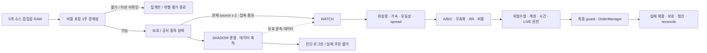

# 주식자동매매 V1.1 후속 버전

빌드: **V1.1-audit-20261002** / 전략 식별자: `V1.1-policy-20261001`.
기존 주문·체결·복구 코어를 유지하면서 후보 관찰, 평가 연결, 부하와 사용자 시작 절차를 수정했습니다. 회귀검사와 합성 경로 검증은 수익성이나 실제 매수·청산 체결 성공을 증명하지 않습니다.

## 사용자가 평소 할 일

바탕화면 **주식자동매매_실행.cmd**를 더블클릭하고, 지원시간에 **자동매매 시작**을 누릅니다. 창을 여는 것만으로 주문하지 않습니다. 시작 버튼이 연결·계좌·보호정책·장부·필요한 재자격 검사와 LIVE 준비를 순서대로 처리합니다.

- 최초 또는 현재 빌드의 유효한 증빙이 없으면 조회 전용 150초 검사. 진행률 후에도 실제 결과가 나올 때까지 `결과 정리 중`으로 기다립니다. PASS는 시간 경과로 만들어지지 않습니다.
- 승인한도 0원은 ARMED 관찰만 합니다. 판단은 계속하며 주문/가상 보유는 만들지 않습니다.
- 양수 한도에서 비용이 미확정이면 실제 확인한 비용을 입력·확인해야 합니다. 예시 비용을 자동 승인하지 않습니다.
- 새 LIVE 승인이 필요하면 **현재 승인한도와 같은 원 단위 금액** 및 `실제매매승인`을 입력합니다. 마지막 문구를 확인하면 승인 저장과 감시 시작이 이어집니다. 재자격 PASS만으로 LIVE가 되지 않습니다.
- 현재 빌드의 유효한 기존 승인으로 재개해도 계좌/연결을 다시 검사하고 실제 시작을 확인합니다. 실행 중 한도·LIVE 설정을 바꾸지 않습니다.

자세한 클릭 순서는 [사용자 가이드](사용자_시운전_가이드.txt), 화면 의미는 [GUI 안내](GUI_GUIDE.md), 다음 정규장 확인은 [NEXT_SESSION_CHECK](NEXT_SESSION_CHECK.md)를 따릅니다. 기존 콘솔/명령은 호환 경로로 유지되며 일반 사용자는 직접 명령을 입력할 필요가 없습니다.

## 시간과 기존 보유 보호

지원시간은 한국시간 **09:00:00 이상 15:20:00 미만**입니다. 실제 시장 확인도 필요합니다. 신규진입은 **15:05 미만**, 봇 청산 시작은 **15:10**, `ALLOW_OVERNIGHT=false`입니다. 15:20은 이 프로그램의 지원 종료이지 거래소 폐장 시각을 뜻하지 않습니다. 미청산·UNKNOWN은 성공으로 처리하지 않으며 HTS 확인이 필요합니다.

| 기존 보유 | 정책 | 자동 경로의 권한 |
|---|---|---|
| 삼성전자 005930 | HARD_LOCK / MANUAL_HOLD | 자동 BUY/SELL/추가매수/재배치 금지. 최종 broker guard에서 재차 차단 |
| 광전자 017900 | HARD_LOCK | 강제 청산·STOP_FLAT·KILL 이유로도 SELL 금지 |
| 현대바이오랜드 052260 | BREAKEVEN_EXIT, 기준 5,834원 | 기준 이상에서 기존 보호수량 전량을 실제 매도할 수 있는 신선한 호가/잔고와 명시 권한이 있을 때만 종료. 그 전 매도·추가매수 금지 |
| 나인테크 267320 | 외부보유 보호 | 종료된 1주 시험매도 기능을 일상 GUI에서 다시 승인하지 않음. 과거 고립된 합성 계약 검사는 보존 |

기회비용 엔진은 현 보유 정책을 대체하지 않습니다. 봇 포지션과 외부보유를 분리합니다. 현금·매도대금·봇 수익이 늘어도 사용자 승인한도는 자동 증액되지 않습니다.

## 후보부터 주문까지

RAW는 기존 `ka10029 / ka10032 / ka10027 / ka00198 / ka10031` ranking 응답의 고유종목 합집합입니다. HTS 0168 목록과 동일하다고 간주하지 않습니다. 갱신 간격은 `automation.json`의 `scan_seconds`; 이전 주기 소요시간이 더해질 수 있습니다.

양수 한도에서 `effective_auto_cap=min(신선한 실제 주문가능현금, 사용자 승인한도)`보다 비용 포함 1주 예상금액이 크면 이후 종목 상태조회·일봉·구조·SHADOW·WATCH·Setup에 보내지 않습니다. 전체 RAW 통계에는 포함하고 GUI는 `1주 매수 불가 N종목`으로 집계합니다. 한도 0원에서는 기존 다중소스 관찰판정을 계속하고 최종 주문 단계에서 NO_BUY 처리합니다. 1주 가능을 요구하는 단일소스 SHADOW는 0원 자본에서 새로 선정되지 않습니다.

source 1이라도 1주 가능·보호 제외·공식 정상 상태가 확인되면 SHADOW 데이터 수집이 가능합니다. 최대 32개이며 WATCH, 신선한 강세, 필요한 warmup과 신규 발견을 고려해 교체합니다. SHADOW 가상 Setup/수량은 주문 엔진·포지션을 바꾸지 않습니다. **실제 BUY의 source 기준은 현재 최소 2개로 유지**합니다. 최신 RAW에서 자격이 사라지거나 stale이면 기존 WATCH가 남아 있어도 BUY하지 않습니다.

유효한 연속 구독 데이터는 source 1↔2 때문에 버리지 않습니다. 실제 구독 해제·누락된 분·disconnect·overflow·지연된 틱에는 기존 리셋/차단이 적용됩니다. 단순히 체결 간격이 5초 넘었다는 이유만으로 정상 완성봉을 지우지 않습니다. A/B/C warmup도 실제 사용 가능한 완성봉으로 판정합니다.

`상단 저항 여유 부족`만으로 탈락한 정상 후보는 돌파 A/C 평가에 보낼 수 있습니다. 저항 접근이 매수 신호는 아닙니다. B의 여유 기준, 거래대금·상단 밀집·이력·추격·stop 거리·RR·비용·위험·LIVE 조건은 유지합니다. A/C가 실제로 넘은 옛 저항은 목표의 상한에서만 제외하며 다음 미돌파 저항은 계속 제한합니다. 이 변경은 실제 평가 순서와 데이터 가용성을 바꾸므로 상세 근거와 검사는 [AUDIT_REPORT](AUDIT_REPORT.md)에 명시했습니다.

## 진입·수량·보유·청산 규칙

A는 관측 고점 돌파와 최근 2개 완성봉 지지, B는 상승→거래량 감소 눌림→고점 재돌파, C는 좁은 완성봉 박스 돌파입니다. 형상 후보, 공통 gate 통과, 실제 신호, 주문 자격은 서로 다릅니다. 가속이 실패해도 형상 시도와 실패 이유는 기록합니다.

수량은 `min(자본으로 가능한 수량, 위험예산으로 가능한 수량)`입니다. 한 주 예상 위험은 `진입가-무효화가 + 왕복 비용 + 무효화가 기준 예상 청산 슬리피지`; 거래 위험예산은 현재 자본 기준 0.3%와 남은 위험한도 중 작은 값입니다. 20,000원에서는 기본 위험예산 60원이므로 1주를 살 현금이 있어도 수량 0일 수 있습니다. 예시/추정 비용과 실제 증권사 비용은 구분합니다.

실제 체결 후 무효화 가격을 포지션의 초기 보호선에 저장합니다. 현재가 또는 매수1호가가 보호선 이하이면 매수 미체결 취소 확인 후 시장가 청산을 요청합니다. 브로커에 미리 걸어 둔 stop 주문이 아니라 로컬 감시와 청산 주문입니다.

1R 이상 유리하게 움직이면 비용 추정 바닥, 최고가 trailing, 완성봉 저점, 미실현이익 유지선을 비교해 보호선을 올립니다. **보호선은 내려가지 않습니다.** 고정 +3/+5/+6% 익절은 없습니다. 목표는 진입 경제성 평가용이고 실제 청산 고정 가격이 아닙니다. 보호선 위에서는 추세를 보유하며 보호선 이탈·시세 지연·운영 청산·STOP_FLAT/KILL 등에 청산을 요청합니다.

매도 거절은 제한 횟수 재시도 후 HALT와 청산 의도를 남깁니다. 불명확 주문은 중복 전송하지 않고 조회/취소 확인을 기다립니다. 부분체결은 실제 누적 체결 및 잔량 기준입니다. 계좌 수량 불일치는 SELL을 차단하고 포지션을 삭제하지 않습니다. 급락·호가 공백·API 장애에서는 계획 손실을 초과하거나 미청산이 남을 수 있습니다. HTS 확인과 사용자 대응이 필요하며 무조건 최대 손실 보장/당일 청산 성공이라고 표현하지 않습니다.

## 중지 버튼

| 버튼 | 실제 의미 |
|---|---|
| 신규매수 중지 | STOP. 신규진입 금지·매수 미체결 정리. 기존 봇 보호를 계속하며 안전 종료까지 대기 |
| 봇 보유 전량청산 후 중지 | STOP_FLAT. 봇 잔량 청산과 미체결 정리를 요청. 체결 확인 전 완료 표시하지 않음 |
| 긴급정지 | KILL. 기존 비상정지/청산 절차. 실패/UNKNOWN은 HTS 확인. HARD_LOCK과 외부보유 보호 유지 |

창 닫기와 감시 종료는 다릅니다. 창만 닫으면 별도 runner가 남을 수 있으므로 종료 확인창의 설명을 따르세요. PID·실제 프로세스·heartbeat를 확인해 중복 runner를 막습니다. heartbeat가 오래됐다고 살아 있는 PID를 무시해 새 runner를 만들지 않습니다.

## 기록·계측·설정

기존 `events.jsonl`/`trade_review`를 유지합니다. RAW 최초 가격·시각, WATCH 승격/강등, source 변화, 데이터 유지/해제, 실제 gate 숫자/시도/무효화/수량을 추가 기록합니다. SHADOW는 별도 `runtime/shadow_events.jsonl`, `runtime/shadow_snapshot.json`에 `SHADOW_ONLY=true`, `actual_order_permission=false`를 명시합니다. 화면은 살아 있는 후보·봇 보유 상태를 먼저 보여주고 반복 불가/외부보유 HOLD는 요약합니다. 원본 machine log는 보존합니다.

후보 주기의 API 대기·HTTP·상태/일봉/구조·평균/최대 시간, 계좌/외부보유 조회, SHADOW 평가/큐 누락을 계측합니다. 기존 로그의 후보 완료 간격은 처리시간 실측이 아닙니다. SHADOW의 detector와 큐는 분리했지만 CPU/GIL, API 키 및 WebSocket 구독은 공유하므로 실시장 부하 영향은 다음 세션에서 확인해야 합니다.

관찰 용량/주기는 선택적인 `observation.json`으로 분리했고 예시는 `observation.example.json`입니다. 실제 주문 위험·LIVE·한도를 이 파일에서 바꿀 수 없습니다. 기존 설치에 actual 설정파일을 자동 생성하거나 덮어쓰지 않습니다.

외부보유 현대바이오랜드는 기준에서 충분히 멀면 호가/상태 조회 최대 30초, 접근/가격 미확인 시 기존 5초 확인을 유지합니다. 계좌 reconcile 주기와 전량 매도 조건은 그대로이며 오래된 호가로 SELL하지 않습니다.

## 개발자/인수 검증

기존 `candidate_builder.py → symbols_today.csv → main.py → swing_summary.xlsx` 진입점과 `run.bat`, continuous runner, 콘솔은 보존했습니다. 일상 GUI는 operator service를 호출하며 broker를 직접 호출하지 않습니다.

새 설치에는 Python 3.11 이상 및 requirements가 필요합니다. `tools/setup_local.py`는 기존 설정을 덮어쓰지 않습니다. 예시는 cap 0·live_mode false·costs_confirmed false입니다. 실제 `.env`, config/automation/승인, runtime, 계좌·보고서·vendor는 Git에 넣지 않습니다. 업로드 절차는 [REPOSITORY_GUIDE](REPOSITORY_GUIDE.md), 안전 검사는 `tools/repo_guard.py`입니다. 이번 작업은 Git 동기화/commit/push를 하지 않습니다.

오프라인 검사 예: `python -m unittest discover -s tests`. 설치본의 vendor/gui_vendor 의존성과 UTF-8 실행환경이 필요할 수 있습니다. Qt 검사는 offscreen 합성 서비스입니다. `tools/session_audit.py`는 저장 로그를 오프라인 집계하며 HTS 목록/시각이 없는 경우 선행 포착률을 추정하지 않습니다. `tools/offline_benchmark.py`는 합성 CPU/큐 계측이며 실시장 전체 성능이 아닙니다.

검증 결과와 남은 실시장 항목은 [TEST_REPORT](TEST_REPORT.md)에 기록합니다. 이전 날짜 문서는 과거 작업 기록이며 현행 운영 절차는 이 README, GUI_GUIDE, 사용자 가이드와 NEXT_SESSION_CHECK를 우선합니다.
